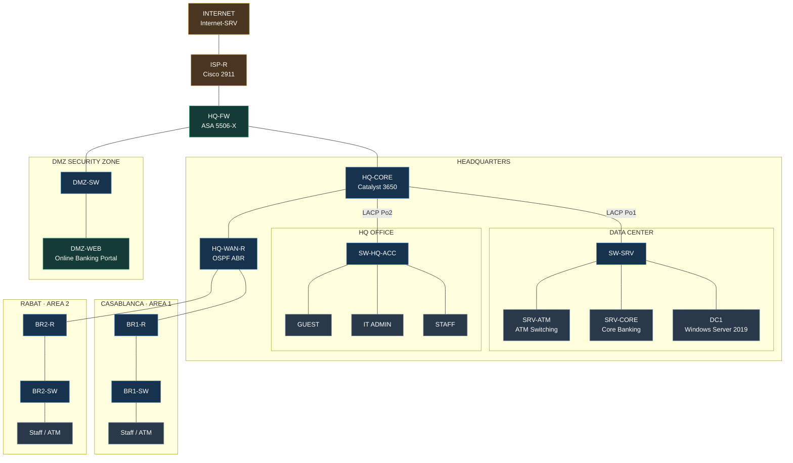
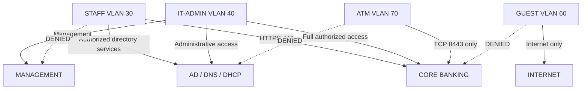
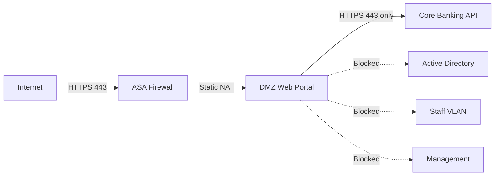
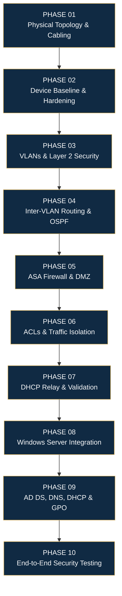

# ATLAS BANK
### Secure Financial Network Infrastructure

<p align="center">
  
  
  
</p>

<p align="center">
  <strong>Designing and securing a multi-site banking infrastructure through network segmentation, centralized identity management, secure routing, and perimeter defense.</strong>
</p>

---

## 01. PROJECT OVERVIEW

**Atlas Bank** is an enterprise-grade network infrastructure project simulating the IT environment of a modern financial institution.

The organization operates across three geographical locations:

- **Headquarters (HQ):** Centralized data center, banking servers, identity infrastructure, administration, and Internet connectivity.
- **Casablanca Branch (BR1):** Banking operations, teller workstations, and ATM infrastructure.
- **Rabat Branch (BR2):** Banking operations, teller workstations, and ATM infrastructure.

The infrastructure is designed around a defense-in-depth security model, where network segmentation, routing authentication, access control, perimeter inspection, and centralized identity management work together.

The implementation combines Cisco Packet Tracer with a real Windows Server 2019 virtual machine and a Windows 10 Pro domain client.

### Project Mission

Build a banking network in which every system, user, and service operates within an explicitly defined security boundary.

> A banking network must not simply provide connectivity. It must enforce trust.

---

## 02. INFRASTRUCTURE AT A GLANCE

| Component | Implementation |
|---|---|
| Network simulator | Cisco Packet Tracer |
| Core switching | Cisco Catalyst 3650 |
| Access switching | Cisco Catalyst 2960 |
| Routing | Cisco 2911 |
| Perimeter firewall | Cisco ASA 5506-X |
| Routing protocol | OSPF Multi-Area |
| Routing authentication | OSPF MD5 |
| Switching redundancy | LACP EtherChannel |
| Spanning Tree | Rapid-PVST+ |
| Identity management | Windows Server 2019 |
| Directory services | Active Directory Domain Services |
| DNS | Windows DNS |
| DHCP | Windows DHCP |
| Endpoint | Windows 10 Pro |
| File services | SMB / NTFS |
| Virtualization | VMware |

### Network Capabilities

- Three-site enterprise topology.
- Centralized Internet breakout.
- Dedicated DMZ for the online banking portal.
- Departmental and infrastructure VLAN segmentation.
- Dynamic inter-site routing.
- Authenticated OSPF adjacencies.
- Centralized identity and addressing.
- Extended ACL-based traffic restrictions.
- Layer 2 attack mitigation.
- Secure administrative access.
- Windows Group Policy enforcement.

---

## 03. NETWORK ARCHITECTURE

### High-Level Topology

The infrastructure follows a hierarchical architecture consisting of access, core, WAN, and perimeter layers.



### Architectural Principles

| Layer | Responsibility |
|---|---|
| Access | Endpoint connectivity and VLAN assignment |
| Core | Inter-VLAN routing, ACLs, and DHCP relay |
| WAN | Multi-area OSPF and branch connectivity |
| Perimeter | Stateful inspection, NAT, and DMZ isolation |
| Identity | Centralized authentication and policy |
| Endpoint | Domain security and operating system controls |

---

## 04. MULTI-SITE ROUTING DESIGN

The network uses OSPF with a multi-area architecture.

| Area | Location | Router |
|---|---|---|
| Area 0 | HQ backbone | HQ-CORE / HQ-WAN-R |
| Area 1 | Casablanca | BR1-R |
| Area 2 | Rabat | BR2-R |

HQ-WAN-R acts as the Area Border Router (ABR), connecting the backbone to both branch areas.

### Routing Security

- OSPF process 1.
- Static router IDs using loopbacks.
- Point-to-point WAN links.
- MD5 message-digest authentication.
- Passive interfaces on non-routing segments.
- Default route propagation from HQ.

### Point-to-Point Addressing

| Link | Network | Side A | Side B |
|---|---|---|---|
| HQ-CORE ↔ HQ-WAN-R | 10.255.0.4/30 | .6 | .5 |
| HQ-WAN-R ↔ BR1-R | 10.255.1.0/30 | .1 | .2 |
| HQ-WAN-R ↔ BR2-R | 10.255.2.0/30 | .1 | .2 |

**OSPF Authentication Key:** `Atl@s0spf`

---

## 05. VLAN & SECURITY ZONES

Each VLAN represents a separate trust zone.

| VLAN | Zone | Headquarters | Casablanca | Rabat |
|---:|---|---|---|---|
| 10 | SRV-INFRA | 10.10.10.0/24 | — | — |
| 20 | SRV-COREBANK | 10.10.20.0/24 | — | — |
| 30 | STAFF | 10.10.30.0/24 | 10.20.30.0/24 | 10.30.30.0/24 |
| 40 | IT-ADMIN | 10.10.40.0/24 | — | — |
| 50 | MGMT | 10.10.50.0/24 | 10.20.50.0/24 | 10.30.50.0/24 |
| 60 | GUEST | 10.10.60.0/24 | — | — |
| 70 | ATM | — | 10.20.70.0/24 | 10.30.70.0/24 |
| 99 | NATIVE | Native VLAN | Native VLAN | Native VLAN |
| 999 | BLACKHOLE | Unused ports | Unused ports | Unused ports |

### Traffic Isolation



### Security Policy

| Source | Destination | Policy |
|---|---|---|
| Staff | AD / DNS | Authorized services |
| Staff | Core Banking | HTTPS 443 |
| IT Admin | Internal infrastructure | Administrative access |
| ATM | ATM Server | TCP 8443 |
| Guest | Internal networks | Deny |
| Guest | Internet | Allow |
| Internet | DMZ | HTTP/HTTPS to portal |
| DMZ | Core Banking | HTTPS API only |
| DMZ | Other internal zones | Deny |

---

## 06. PERIMETER SECURITY & DMZ

The perimeter is protected by a Cisco ASA 5506-X firewall.

### Three Security Interfaces

| Interface | Security Level | Network |
|---|---:|---|
| outside | 0 | 203.0.113.0/29 |
| inside | 100 | 10.255.0.0/30 |
| dmz | 50 | 172.16.100.0/24 |

### NAT Architecture

**Dynamic PAT**

Internal networks use the ASA outside interface address for outbound Internet connectivity.

**Static NAT**

The online banking portal is mapped to a dedicated public address:

| Host | Private IP | Public IP |
|---|---|---|
| DMZ-WEB | 172.16.100.10 | 203.0.113.3 |

### DMZ Security Flow



The public portal must never have unrestricted access to the internal banking infrastructure.

---

## 07. LAYER 2 HARDENING

Access switches implement additional controls to reduce common Layer 2 attacks.

| Security Control | Implementation |
|---|---|
| Port Security | Sticky MAC, maximum MAC limit |
| DHCP Snooping | Trusted uplinks and rate-limited access ports |
| BPDU Guard | Protected endpoint-facing interfaces |
| PortFast | Edge port acceleration |
| Rapid-PVST+ | Rapid spanning-tree convergence |
| Native VLAN | VLAN 99 |
| Blackhole VLAN | VLAN 999 |
| Unused Ports | Administratively shut down |
| EtherChannel | LACP active mode |

### EtherChannel Design

- Po1: HQ-CORE ↔ SW-SRV
- Po2: HQ-CORE ↔ SW-HQ-ACC

Both use LACP with 802.1Q trunking.

---

## 08. CENTRALIZED WINDOWS INFRASTRUCTURE

The Windows environment provides centralized identity, network services, and endpoint management.

### Domain Controller: DC1

| Service | Technology | Responsibility |
|---|---|---|
| Identity | AD DS | Centralized authentication |
| Name Resolution | DNS | Internal domain resolution |
| Address Management | DHCP | Dynamic IP assignment |
| Endpoint Policy | GPO | Security enforcement |
| File Services | SMB | Centralized file sharing |
| Permissions | NTFS | Least-privilege access |

**Domain:** `atlasbank.local`

**Domain Controller IP:** `10.10.10.10/24`

**Gateway:** `10.10.10.1`

### Windows 10 Domain Client

The Windows 10 Pro workstation connects to the HQ STAFF VLAN and is used to validate:

- DHCP address allocation.
- DNS resolution.
- Active Directory domain joining.
- Domain authentication.
- Group Policy application.
- File server access.
- Banking application connectivity.
- Network isolation.

### Group Policy Security Baseline

Planned policies include:

- Password complexity and account lockout.
- Automatic workstation inactivity locking.
- Windows Defender Firewall enforcement.
- USB storage restrictions.
- Legal logon banner.
- Security event auditing.
- Restricted administrative access.

---

## 09. IP ADDRESSING & INFRASTRUCTURE INVENTORY

### Core Infrastructure

| Device | Address |
|---|---|
| DC1 | 10.10.10.10 |
| SRV-CORE | 10.10.20.10 |
| SRV-ATM | 10.10.20.20 |
| SW-HQ-ACC | 10.10.50.11 |
| SW-SRV | 10.10.50.12 |
| BR1-SW | 10.20.50.2 |
| BR2-SW | 10.30.50.2 |
| DMZ-WEB | 172.16.100.10 |

### Gateway Convention

Each user and server VLAN uses `.1` as its default gateway.

Infrastructure servers use static addressing.

Staff and ATM endpoints use centralized Windows DHCP, while the HQ guest network uses a local DHCP pool on HQ-CORE.

---

## 10. IMPLEMENTATION ROADMAP

The project is divided into controlled implementation phases to ensure that each layer can be tested before introducing additional complexity.



### Phase 01 — Network Foundation

- [ ] Build the complete Packet Tracer topology.
- [ ] Configure all physical and logical connections.
- [ ] Apply device hostnames and baseline security.
- [ ] Create VLANs and trunk links.
- [ ] Configure LACP EtherChannels.
- [ ] Enable Rapid-PVST+ and Layer 2 protections.

### Phase 02 — Routing & Segmentation

- [ ] Configure Layer 3 SVIs.
- [ ] Configure routed core uplinks.
- [ ] Configure branch router-on-a-stick.
- [ ] Implement OSPF multi-area.
- [ ] Enable MD5 authentication.
- [ ] Configure extended ACLs.
- [ ] Validate inter-VLAN restrictions.

### Phase 03 — Perimeter Defense

- [ ] Configure ASA security interfaces.
- [ ] Configure PAT for internal networks.
- [ ] Configure static NAT for the DMZ portal.
- [ ] Apply outside and DMZ ACLs.
- [ ] Validate Internet access.
- [ ] Verify DMZ isolation.

### Phase 04 — Windows Integration

- [ ] Connect VMware Windows Server 2019.
- [ ] Configure the server network interface.
- [ ] Install AD DS and DNS.
- [ ] Configure DHCP scopes.
- [ ] Create the `atlasbank.local` domain.
- [ ] Join Windows 10 Pro to the domain.
- [ ] Deploy security GPOs.
- [ ] Configure SMB and NTFS permissions.

### Phase 05 — Security Validation

- [ ] Test routing adjacencies.
- [ ] Verify DHCP and DNS.
- [ ] Test domain authentication.
- [ ] Validate firewall behavior.
- [ ] Test allowed and denied ACL traffic.
- [ ] Verify management-plane restrictions.
- [ ] Document evidence and results.

---

## 11. NETWORK VALIDATION

A secure network is not complete until its security controls have been tested.

### Cisco Verification Commands

**Routing**

```cisco
show ip ospf neighbor
show ip route ospf
show ip protocols
```

**Switching**

```cisco
show etherchannel summary
show vlan brief
show interfaces trunk
show spanning-tree
```

**Security**

```cisco
show ip access-lists
show ip dhcp snooping
show ip dhcp snooping binding
show port-security
show port-security address
```

**ASA**

```cisco
show interface ip brief
show route
show nat
show access-list
show xlate
```

### Windows Validation

```powershell
ipconfig /all
nslookup atlasbank.local
nltest /dsgetdc:atlasbank.local
gpresult /r
gpupdate /force
whoami /all
```

### Security Test Matrix

| Test | Expected Result |
|---|---|
| Staff → Banking HTTPS | ALLOW |
| Staff → Management VLAN | DENY |
| ATM → ATM Server TCP 8443 | ALLOW |
| ATM → Active Directory | DENY |
| Guest → Internet | ALLOW |
| Guest → Internal Servers | DENY |
| Internet → Public Portal HTTPS | ALLOW |
| Internet → Internal Infrastructure | DENY |
| DMZ → Core Banking HTTPS | ALLOW |
| DMZ → Other Internal Zones | DENY |
| Unauthorized SSH | DENY |

---

## 12. REPOSITORY STRUCTURE

Suggested documentation and configuration organization:

```text
ATLAS-BANK/
│
├── README.md
│
├── topology/
│   ├── AtlasBank.pkt
│   ├── topology.png
│   └── addressing-plan.md
│
├── configurations/
│   ├── routers/
│   │   ├── ISP-R.cfg
│   │   ├── HQ-WAN-R.cfg
│   │   ├── BR1-R.cfg
│   │   └── BR2-R.cfg
│   │
│   ├── switches/
│   │   ├── HQ-CORE.cfg
│   │   ├── SW-SRV.cfg
│   │   ├── SW-HQ-ACC.cfg
│   │   ├── BR1-SW.cfg
│   │   └── BR2-SW.cfg
│   │
│   └── firewall/
│       └── HQ-FW.cfg
│
├── windows-server/
│   ├── active-directory/
│   ├── dns/
│   ├── dhcp/
│   ├── group-policy/
│   └── file-services/
│
├── security/
│   ├── acl-matrix.md
│   ├── firewall-policy.md
│   ├── layer2-hardening.md
│   └── security-validation.md
│
├── documentation/
│   ├── architecture.md
│   ├── vlan-plan.md
│   ├── routing-design.md
│   └── test-results.md
│
└── screenshots/
    ├── topology/
    ├── routing/
    ├── firewall/
    ├── windows-server/
    └── validation/
```

---

## 13. FUTURE EXPANSION — PHASE 02

The infrastructure is designed to support additional enterprise security and availability features.

Planned enhancements:

- Dual WAN connectivity.
- HSRP gateway redundancy.
- Firewall high availability.
- Enhanced network monitoring.
- Centralized Syslog and SNMP.
- Network intrusion detection.
- SIEM integration.
- Automated configuration backups.
- Advanced Windows security auditing.
- Infrastructure monitoring dashboards.

These enhancements are separate from the initial implementation and will be documented when deployed and validated.

---

## 14. PROJECT OBJECTIVES

This project demonstrates practical knowledge of:

- Enterprise network architecture.
- Cisco switching and routing.
- Multi-area OSPF.
- Network segmentation and ACLs.
- Firewall and DMZ architecture.
- Layer 2 security.
- Windows Server administration.
- Active Directory and Group Policy.
- Network troubleshooting.
- Security testing and technical documentation.

---

## 15. PROJECT STATUS

| Deliverable | Status |
|---|---|
| Architecture design | Defined |
| IP addressing plan | Defined |
| VLAN and security zones | Defined |
| Packet Tracer topology | Implementation |
| Cisco configurations | Implementation |
| Firewall and DMZ | Implementation |
| Windows Server integration | Planned |
| Security validation | Pending |

**Project:** Atlas Bank — Secure Financial Network Infrastructure

**Environment:** Cisco Packet Tracer + VMware

**Focus:** Enterprise Networking / Network Security / Windows Server Administration

---

<p align="center">
  <strong>ATLAS BANK</strong>
  <br/>
  <sub>SECURE CONNECTIVITY. CONTROLLED ACCESS. TRUSTED INFRASTRUCTURE.</sub>
  <br/><br/>
  
  
  
</p>
